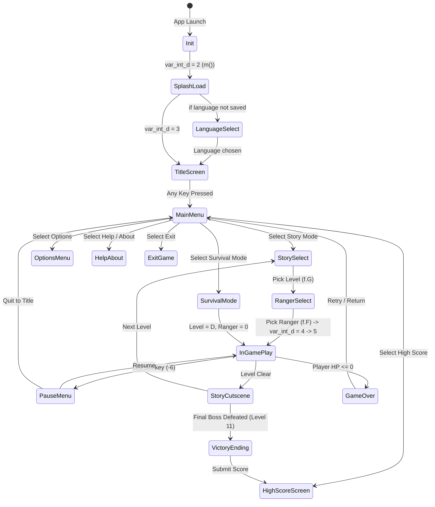

# Power Rangers: Mystic Force (J2ME) - Complete Reverse Engineering & Codebase Analysis

## 1. Executive Summary & Verification of Section 1 Claims

The game is **Power Rangers: Mystic Force**, developed by **Living Mobile** (2006) for Nokia J2ME MIDP-1.0/CLDC-1.0 devices with a 240x320 display. The codebase consists of 8 obfuscated classes in the default package, built on top of Living Mobile's proprietary 2D action/platforming engine.

Every claim from Section 1 of the brief has been verified against the JAR archive, CFR 0.152 decompilation output, and `javap` bytecode disassembly:

- **Manifest Attributes:** `[verified]`
  - `MIDlet-Name: Power Rangers sefan.ru`
  - `MIDlet-Vendor: Living Mobile`
  - `MIDlet-Version: 2.0.0`
  - `MicroEdition-Profile: MIDP-1.0`
  - `MicroEdition-Configuration: CLDC-1.0`
  - `MIDlet-1: Power Rangers sefan.ru, i.png, GMIDlet`
  - `MIDlet-Icon: i.png`
  - `MIDlet-Data-Size: 2000`
- **JAR Size:** `[verified]`
  - Exactly `246,611 bytes`
- **Class Count & Lines:** `[verified]`
  - Total: 8 classes. Line counts match initial estimates:
    - `GMIDlet`: 643 lines (~650)
    - `g`: 2,123 lines (~2,100)
    - `f`: 2,674 lines (~2,700)
    - `a`: 763 lines (~770)
    - `b`: 227 lines (~230)
    - `c`: 559 lines (~560)
    - `d`: 518 lines (~520)
    - `e`: 188 lines (~190)
- **Resource Families:** `[verified]`
  - `bg0..bg4` (5 files): Length-prefixed PNG parallax backgrounds (`[verified]`)
  - `b0..b12` (13 files): Tile/block definition tables, 16x16 tiles (`[verified]`)
  - `l0..l12` (13 files): Level layouts, entity spawns, triggers (`[verified]`)
  - `s0..s64` (55 files): Sprite graphics sheets, length-prefixed PNGs (`[verified]`)
    - *Note:* Sprite indices 28, 29, 37, 38, 39, 40, 42, 43, 44, 45 are omitted in this build.
  - `lm`, `lp__{de,en,fr,it}`, `lpok`, `subtitle__{de,en,fr,it}`: Length-prefixed PNGs (`[verified]`)
  - `l` (55,950 bytes): Master pack containing configuration tables, level tables, cutscene PNGs, and audio payloads (`[verified]`)
  - `spr` (39,396 bytes): Sprite animation frame offset pack (`[verified]`)
  - `fr` (2,809 bytes): Hitbox/bounding rect definitions (`[verified]`)
  - `font` (2,066 bytes): Header metrics + PNG font sheet (`[verified]`)
  - `text__{de,en,fr,it}.txt` (4 files): 46 UTF strings each, length-prefixed (`[verified]`)
  - `lang` (18 bytes): Language table (`de`, `en`, `fr`, `it`) (`[verified]`)
  - `i.png` (900 bytes): Standard icon PNG (`[verified]`)
- **Audio Location:** `[verified]`
  - Audio data resides directly inside the `/l` master pack stream and is read by `e.a(DataInputStream)`.

---

## 2. High-Level Class Architecture & Roles

```
               +--------------------------------------+
               |               GMIDlet                |
               |  (MIDlet Lifecycle, Font, Graphics)  |
               +-------------------+------------------+
                                   |
                                   v
               +--------------------------------------+
               |                  g                   |
               |   (Canvas, App State Machine, RMS,   |
               |     Master Loader, Top-Level Loop)   |
               +----------+--------+--------+---------+
                          |        |        |
         +----------------+        |        +-----------------+
         |                         |                          |
         v                         v                          v
  +--------------+          +--------------+           +--------------+
  |      d       |          |      f       |           |      e       |
  | (UI Screens, |          | (In-Level    |           | (Audio Mgr,  |
  |  Menu Loop)  |          |  Gameplay)   |           |  MIME Table) |
  +-------+------+          +----+----+----+           +--------------+
          |                      |    |
          v                      |    +----------------+
  +--------------+               |                     |
  |      b       |               v                     v
  |  (UI Widgets |        +--------------+      +--------------+
  |   & Items)   |        |      c       |      |      a       |
  +--------------+        |  (Tilemap &  |      |   (Sprites,  |
                          |   Collision) |      |  Hitboxes)   |
                          +--------------+      +--------------+
```

| Class | Role Summary `[verified]` | Resources Loaded Directly `[verified]` |
|---|---|---|
| `GMIDlet` | MIDlet entry point. Initializes Display, full screen mode, provides static font rendering (`/font`), PNG slice loaders, and graphics wrappers. | `i.png`, `/font` (delegated) |
| `g` | Core Canvas and main thread loop. Owns the application state machine, language selection, RMS save/load, UI form flow, and master pack loading. | `/lm`, `/lp__*`, `/lpok`, `/font`, `/text__*.txt`, `/lang`, `/l`, `/fr`, `/spr`, `/subtitle__*` |
| `f` | Core gameplay loop (70 ms fixed step). Handles player physics, combat combos, magic spells, enemy AI, bosses, projectiles, HUD, and camera. | `/l0..l12`, `/b0..b12`, `/bg0..bg4` |
| `a` | Actor & sprite representation. Encapsulates frame sequences, hitbox evaluation, screen positioning, and flip transformations. | `/s0..s64` |
| `b` | UI widget element. Encapsulates text items, spinners, separators, image items, and sub-menus. | None (uses preloaded graphics) |
| `c` | Tilemap engine, scrolling camera viewport, and 16x16 grid collision detector. | None (passed streams by `f`) |
| `d` | Screen / Form container for UI widgets. Manages selection navigation and runs a 100 ms repaint thread. | None (aggregates `b` items) |
| `e` | Audio engine. Controls `javax.microedition.media.Player` playback, volume control, and MIME format resolution. | Reads audio segment from `/l` |

---

## 3. Bytecode Resolution of CFR Trouble Spots in `g` `[verified]`

Five methods in `g` triggered warnings during CFR decompilation. All five were audited directly from bytecode (`decompiled/bytecode/g.txt`):

### 3.1 `q()` - Intro & Logo Screen Loader
- **Decompiler Warning:** `Loose catch block`.
- **Bytecode Reality:** Method opens `/lm` as `DataInputStream`, decodes logo image 1 via `GMIDlet.a(dis, -1)`, sleeps for 500 ms (`Thread.sleep(500L)`), decodes logo image 2, paints the Living Mobile intro, and cleanly ignores `InterruptedException` / `IOException` via a simple catch table `[from=29, to=35, target=45, type=Exception]`.

### 3.2 `h()` - Restore Save Progress
- **Decompiler Warning:** `Loose catch block`.
- **Bytecode Reality:** Wraps `var_byte_arr_a` (the in-memory save byte array) into a `ByteArrayInputStream` and `DataInputStream`, then delegates to `f.a(DataInputStream)`. The bytecode exception table contains a standard finally block ensuring `DataInputStream.close()` is executed even if deserialization fails.

### 3.3 `i()` - Backup Save Progress
- **Decompiler Warning:** `Loose catch block`.
- **Bytecode Reality:** Allocates a `ByteArrayOutputStream` and `DataOutputStream`, invokes `f.a(DataOutputStream)` to serialize current game progress, and stores the resulting byte array into `var_byte_arr_a` before closing streams in a `finally` block.

### 3.4 `k()` - RMS Load Options & High Scores
- **Decompiler Warning:** `Unable to fully structure code`.
- **Bytecode Reality:** Control flow graph decoded:
  1. Opens RecordStore `"op"` (`openRecordStore("op", false)`).
  2. If record 1 exists, reads it into `DataInputStream`.
  3. If opening or reading throws `RecordStoreException` or `IOException`, it sets an error flag `istore_3 = 1`, closes the store, and calls `RecordStore.deleteRecordStore("op")`.
  4. Allocates two 5-element integer arrays: `a = new int[5]` (story high scores) and `b = new int[5]` (survival high scores).
  5. Deserializes record 1:
     - `short len`: length of saved game state.
     - If `len > 0`, reads `len` bytes into `var_byte_arr_a` in reverse byte order.
     - Reads 5 integers into `a:[I` (story mode scores).
     - Reads 5 integers into `b:[I` (survival mode scores).
     - Reads options byte `var_byte_b` (audio volume and sound flags).

### 3.5 `a(DataOutputStream, ByteArrayOutputStream, boolean)` - RMS Save Serialization
- **Decompiler Warning:** `Loose catch block`.
- **Bytecode Reality:**
  1. If `var_byte_arr_a != null`:
     - Writes `writeShort(len)`.
     - Writes payload in **reverse order**: `for (int i = len - 1; i >= 0; i--) writeByte(a[i])`.
  2. If `var_byte_arr_a == null`: writes `writeShort(0)`.
  3. Writes high scores:
     - `for (int i = 0; i < 5; i++) { writeInt(a[i]); writeInt(b[i]); }`
  4. Flushes buffer, opens RecordStore `"op"` with `createIfNecessary = true`.
  5. If `getNumRecords() == 0`, calls `addRecord`; otherwise calls `setRecord(1, ...)`.

---

## 4. Class-by-Class Field & Method Maps `[verified]`

### 4.1 Class `GMIDlet`

#### Field Map
| Obfuscated Name | Type | Meaning | Units / Notes |
|---|---|---|---|
| `var_javax_microedition_lcdui_Display_a` | `Display` | J2ME Display singleton | System display handle |
| `var_javax_microedition_lcdui_Graphics_a` | `Graphics` | Cached Graphics context | Active rendering context |
| `var_g_a` | `g` | Main game Canvas instance | Primary canvas |
| `var_javax_microedition_lcdui_Image_arr_a` | `Image[]` | Global image bank (sprites/assets) | Loaded from `/l` and `/s*` |
| `var_short_arr_a` | `short[]` | Global image flags/metadata table | Per-image attribute flags |
| `var_javax_microedition_lcdui_Image_arr_b` | `Image[]` | Font glyph sheet slices | Sliced glyph bitmaps |
| `var_short_arr_b` | `short[]` | Glyph character mapping table | ASCII/Unicode mapping |
| `var_byte_arr_c` / `var_byte_arr_d` | `byte[]` | Font glyph metric tables (widths) | Pixels |
| `var_int_a` | `int` | Total font glyph count | Count |

#### Method Map
| Obfuscated Signature | Role |
|---|---|
| `startApp()V` | Lifecycle start; creates `g`, sets full screen, starts main thread |
| `pauseApp()V` | Lifecycle pause; no-op |
| `destroyApp(Z)V` | Lifecycle shutdown; stops audio `e.a()`, destroys Canvas, notifies runtime |
| `void_a(I)V` | Allocates global image array `var_javax_microedition_lcdui_Image_arr_a` |
| `int_a(I)I` | Returns width of image `n` |
| `b(I)I` | Returns height of image `n` |
| `a(DataInputStream, Image[], short[], I, I, Z)V` | Length-prefixed PNG decoder with palette-swap transform support |
| `a(DataInputStream, I)Image` | Decodes single PNG slice from stream |
| `void_a(DataInputStream)V` | Parses `/font` binary header, metrics, and glyph sheet |
| `a(I, String, I, I, I)V` | Draws text string using bitmap font `n` at `(x, y)` with anchor |
| `a(I, String)I` | Measures width of text string in pixels |
| `c(I)I` | Returns line height of font `n` in pixels |

---

### 4.2 Class `g` (Canvas & Game Coordinator)

#### Field Map
| Obfuscated Name | Type | Meaning | Units / Notes |
|---|---|---|---|
| `var_int_d` | `int` | Top-level application state | 1=init, 2=load, 3=UI/menu, 4=game start, 5=gameplay, -1=exit |
| `var_int_c` | `int` | Active input routing mode | 0=UI/Menu, 1=In-gameplay (`f`) |
| `var_int_e` | `int` | Key code pending processing | Key code |
| `var_long_a` | `long` | Title music playback timer | Milliseconds |
| `var_boolean_c` | `boolean` | Cheat mode active flag | Toggled by `#56*` |
| `var_boolean_d` | `boolean` | Cheat code input entry buffer active | Toggled by `#` |
| `var_java_lang_StringBuffer_a` | `StringBuffer` | 3-character cheat code buffer | String buffer |
| `var_f_a` | `f` | In-game gameplay engine instance | Active gameplay session |
| `var_d_b` | `d` | Main Menu screen | Screen container |
| `var_d_c` | `d` | In-Game Pause Menu screen | Screen container |
| `var_d_d` | `d` | Options Menu screen | Screen container |
| `var_d_e` | `d` | Confirmation prompt screen ("Are you sure?") | Screen container |
| `var_d_f` | `d` | High Score table screen | Screen container |
| `var_d_g` | `d` | Help / Controls screen | Screen container |
| `var_d_h` | `d` | About / Credits / Story Cutscene screen | Screen container |
| `var_d_i` | `d` | Language select screen | Screen container |
| `var_d_k` | `d` | Ranger character select screen | Screen container |
| `var_d_l` | `d` | Level select screen | Screen container |
| `var_byte_b` | `byte` | Audio & vibration settings flags | Bitmask (sound volume, mute, vib) |
| `var_byte_d` | `byte` | Active language index | 0=de, 1=en, 2=fr, 3=it |
| `var_int_g` | `int` | Global accumulated score | Points (capped at 9,999,999) |
| `var_byte_arr_a` | `byte[]` | Serialized in-memory game progress | Save blob |
| `var_int_arr_a` | `int[]` | Story mode top 5 high scores | 5 scores |
| `var_int_arr_b` | `int[]` | Survival mode top 5 high scores | 5 scores / times |
| `z` | `int` | Level selector cursor | Level index (0..12) |

#### Method Map
| Obfuscated Signature | Role |
|---|---|
| `run()V` | Main top-level application loop; coordinates 70 ms wait, state switches, repaint |
| `keyPressed(I)V` | Processes cheat codes (`#56*`), softkey pause (`-6`), and forwards gameplay keys to `f` |
| `keyReleased(I)V` | Forwards key release events to `f.b(int)` |
| `paint(Graphics)V` | Top-level render dispatcher (renders active screen `d` or delegates to `f.d()`) |
| `m()V` | Resource loader: loads `/lm`, `/lang`, `/font`, `/text__*`, `/l`, `/spr`, `/fr` |
| `k()V` | Loads RMS `"op"` save record (high scores, sound options) |
| `g()V` | Saves RMS `"op"` save record (invokes `a(DataOutputStream...)`) |
| `h()V` | Deserializes saved game progress into `f` |
| `i()V` | Serializes current `f` game state into `var_byte_arr_a` |
| `x()V` | Initializes Ranger character select screen (Red, Yellow, Blue, Pink, Green) |
| `y()V` | Instantiates `f` and launches selected level |
| `t()V` | Builds and displays high score screen |
| `b(Z)V` | Displays cutscene screen / ending story sequence |
| `boolean_a(I)Z` | Evaluates whether level `n` is unlocked |

---

### 4.3 Class `f` (In-Game Gameplay Engine)

#### Field Map
| Obfuscated Name | Type | Meaning | Units / Notes |
|---|---|---|---|
| `var_a_f` | `a` | Active Player Ranger sprite | Primary actor entity |
| `var_a_i` | `a` | Active Level Boss sprite | Boss actor entity (or null) |
| `var_a_e` | `a` | Ranger magic power aura sprite | Combat magic visual |
| `var_a_g` | `a` | Particle / hit spark sprite | Particle visual |
| `var_a_arr_g` | `a[]` | Active enemy actors array | Enemy entities in level |
| `var_a_arr_b` | `a[]` | Active projectiles array | Bullets, energy bolts |
| `var_a_arr_c` | `a[]` | Collectible item entities array | Power-ups, health potions |
| `var_a_arr_e` | `a[]` | Interactive level triggers array | Hazard spikes, springs |
| `var_c_arr_a` | `c[]` | Parallax tilemap layers array | Background / foreground layers |
| `G` | `int` | Active level index | 1..12 (or `D` for Survival) |
| `F` | `int` | Active Ranger character ID | 0=Red, 1=Yellow, 2=Blue, 3=Pink, 4=Green |
| `H` | `int` | Highest unlocked level progress | Story progression |
| `an` | `int` | Player magic power gauge | 0..320 |
| `am` | `int` | Maximum magic power gauge | 320 |
| `Q` | `int` | Current input command bitmask | Action bits |
| `var_int_g` | `int` | Accumulated input bitmask | Held buttons bitmask |
| `ac` / `ad` | `int` | Current smooth camera position (X, Y) | World pixels |
| `aa` / `ab` | `int` | Target camera focus position (X, Y) | World pixels |
| `var_java_util_Random_a` | `Random` | Engine pseudo-random number generator | Java LCG instance |
| `aD` | `int` | Screen damage flash timer | Red/white flash countdown |
| `aG` | `int` | Screen shake timer | Shake countdown |
| `var_boolean_j` | `boolean` | God mode / Invincibility cheat flag | Toggled by `#44*` |
| `var_boolean_l` | `boolean` | Game paused flag | Boolean |
| `var_boolean_p` | `boolean` | Level completed / exit flag | Boolean |

#### Method Map
| Obfuscated Signature | Role |
|---|---|
| `boolean_b()Z` | **Main gameplay frame tick**: executes 70 ms step, updates physics, AI, combat, camera |
| `void_a(I)V` | Key press event processor; maps phone keys to action bitmask |
| `b(I)V` | Key release event processor; clears action bitmask bits |
| `int_a(I)I` | Phone keycode mapper (maps `1, 2, 3, 4, 5, 6, 8, 0, D-pad` to action flags) |
| `d()V` | World rendering pipeline: parallax backgrounds, actors, projectiles, HUD |
| `m()V` | HUD renderer: Ranger health bar, magic meter, boss health, score |
| `j()V` | Player movement & basic attack dispatcher based on input bitmask `Q` |
| `k()V` | Special magic spell dispatcher (consumes 320 magic gauge, casts character spell) |
| `e(a)V` | Enemy AI decision tick: evaluates distance, rolls RNG, executes attacks/walk |
| `boolean_a(a, I, I)Z` | Damage resolution: deducts HP, applies flash, checks death, triggers item drops |
| `void_a(a, I, I)V` | Moves actor and evaluates tilemap collisions via `c` |
| `h()V` | Projectile and melee attack hitbox collision evaluations |
| `i()V` | Item collection and hazard contact evaluations |

---

### 4.4 Class `a` (Sprite & Actor Entity)

#### Field Map
| Obfuscated Name | Type | Meaning | Units / Notes |
|---|---|---|---|
| `var_int_d` / `var_int_e` | `int` | Actor world position (X, Y) | World pixels |
| `var_int_f` / `var_int_g` | `int` | Actor velocity (dx, dy) | Pixels / tick |
| `var_int_c` | `int` | Facing direction | 1=Right, 3=Left |
| `var_boolean_a` | `boolean` | Horizontal flip rendering flag | True=Flipped |
| `s` | `int` | Entity archetype / sprite type index | Type ID |
| `t` | `int` | Motion / action state | 0=Idle, 1=Walk, 2=Jump Up, 3=Fall, 4=Crouch, 5=Attack, 6=Approach |
| `x` | `int` | Current animation frame index | Frame index |
| `z` | `int` | Current Health Points (HP) | Hit points |
| `A` | `int` | Maximum Health Points | Max hit points |
| `var_boolean_c` | `boolean` | Death state active flag | True when HP <= 0 |
| `var_boolean_d` | `boolean` | Inactive / dormant flag | True when offscreen/disabled |
| `var_boolean_e` | `boolean` | Stun / hurt state flag | Hit recovery |
| `var_boolean_j` | `boolean` | Active entity flag | Alive in game world |
| `var_boolean_n` | `boolean` | Special action / combo executing flag | Attack active |

#### Method Map
| Obfuscated Signature | Role |
|---|---|
| `void_a(DataInputStream)V` | Static loader: parses `/spr` animation tables and `/fr` hitbox definitions |
| `d(I)V` | Loads entity sprite graphics sheet `/s<N>` |
| `a(I, Z)V` | Sets current animation sequence `n` with loop flag |
| `void_c()` | Advances animation frame by one tick |
| `a(I, I)V` | Renders sprite at `(x, y)` taking into account camera offset and flip flag |
| `int_d() / int_e()` | Computes left / right bounding coordinates (X1, X2) |
| `int_f() / int_g()` | Computes top / bottom bounding coordinates (Y1, Y2) |
| `boolean_a(a)Z` | Evaluates Axis-Aligned Bounding Box (AABB) intersection with another actor |
| `b(a)Z` | Evaluates combat attack hitbox contact with another actor |

---

### 4.5 Class `c` (Tilemap, Viewport & Tile Collision Engine)

#### Field Map
| Obfuscated Name | Type | Meaning | Units / Notes |
|---|---|---|---|
| `var_int_a` | `int` | Tilemap width in tiles | Tile columns |
| `var_int_b` | `int` | Tile size in pixels | 16 pixels |
| `var_int_c` | `int` | Total map width in pixels | `var_int_a * 16` |
| `d` | `int` | Total map height in pixels | Height pixels |
| `var_short_arr_a` | `short[]` | Level tile layout grid | Tile index buffer |
| `var_byte_arr_a` | `byte[]` | Tile collision property flags | 0=Passable, 1=Solid, 2=Platform, 3=Hazard |
| `var_javax_microedition_lcdui_Image_a` | `Image` | Level tileset sheet image | Sliced 16x16 tiles |
| `i` / `j` | `int` | Parallax scrolling scale factors | Ratio x10 (e.g., 10 = 1.0x, 5 = 0.5x) |
| `k` / `l` | `int` | Viewport origin offsets | Scroll offset |

#### Method Map
| Obfuscated Signature | Role |
|---|---|
| `a(DataInputStream)V` | Parses `/b<N>` block properties and `/l<N>` tile grid stream |
| `void_b(I, I)V` | Renders visible tilemap viewport slice to graphics context |
| `a(a, Z, Z)Z` | Tests and resolves vertical collision between actor `a` and solid tiles |
| `void_a(a)V` | Tests and resolves horizontal collision between actor `a` and solid tiles |
| `a(I, I, I, I, I)Z` | Tests rectangular region against specific tile property flags |

---

### 4.6 Class `d` (Menu Screen & Form Container)

#### Field Map
| Obfuscated Name | Type | Meaning | Units / Notes |
|---|---|---|---|
| `var_java_util_Vector_a` | `Vector` | List of `b` UI widgets contained in screen | Child widgets |
| `f` | `int` | Index of currently focused widget | Cursor position |
| `var_b_a` | `b` | Left softkey action widget | Left softkey |
| `var_b_b` | `b` | Right softkey action widget | Right softkey |
| `i` / `j` | `int` | Screen container dimensions | Width, height |
| `n` | `int` | Layout mode flags | Centering, scrolling bits |
| `var_java_lang_Thread_a` | `Thread` | Dedicated 100 ms repaint animation thread | Thread handle |

#### Method Map
| Obfuscated Signature | Role |
|---|---|
| `run()V` | Screen repaint thread; sleeps 100 ms and triggers `var_g_b.repaint()` |
| `a(b, I)V` | Appends widget `b` with custom spacing |
| `a(I)V` | Dispatches menu navigation keys (Up, Down, Left, Right, Select) |
| `a(Graphics)V` | Renders screen title, child widgets, scroll indicators, and softkeys |

---

### 4.7 Class `b` (UI Widget Component)

#### Field Map
| Obfuscated Name | Type | Meaning | Units / Notes |
|---|---|---|---|
| `var_int_b` | `int` | Widget type | 0=Text/Item, 1=Header, 3=Action, 4=Image, 8=Multi-line, 10=Divider |
| `c` | `int` | Selector index for multi-choice items | Current choice index |
| `var_java_lang_Object_a` | `Object` | Widget payload | `String`, `String[]`, `Image`, or `b` |
| `f` | `int` | Action ID triggered upon selection | Dispatched to `g.a(b, d)` |
| `var_boolean_b` | `boolean` | Enabled / selectable flag | Boolean |

#### Method Map
| Obfuscated Signature | Role |
|---|---|
| `a(Graphics, I)V` | Renders widget to screen at specified alignment and focus state |
| `int_a()I` | Calculates widget height in pixels |

---

### 4.8 Class `e` (Audio Engine)

#### Field Map
| Obfuscated Name | Type | Meaning | Units / Notes |
|---|---|---|---|
| `var_java_lang_String_arr_a` | `String[]` | MIME format table | `{"midi", "x-wav", "mpeg", "basic", "x-tone-seq", "x-mid", "x-smaf", "amr", "amr-wb"}` |
| `var_java_lang_Object_arr_a` | `Object[]` | Decoded audio raw byte arrays | Byte arrays from `/l` |
| `var_javax_microedition_media_Player_arr_a` | `Player[]` | Active J2ME Player instances | Player handles |
| `var_int_arr_a` | `int[]` | Audio event to sound ID mapping table | Sound triggers |
| `var_int_b` | `int` | Currently playing sound index | Active sound ID (-1 = none) |
| `var_boolean_b` | `boolean` | Audio enabled flag | Sound enabled |

#### Method Map
| Obfuscated Signature | Role |
|---|---|
| `a(DataInputStream)V` | Loads sound count and extracts byte blobs from `/l` stream |
| `b(I)V` | Plays sound event `n` (stops previous sound, sets volume, loops) |
| `a()V` | Stops currently playing sound and deallocates player |
| `c(I)V` | Closes and releases player `n` |

---

## 5. Subsystem Specifications

### 5.1 Timing & Main Loops `[verified]`
1. **In-Game Play Loop (`f.boolean_b()`):**
   - Fixed target: **70 ms** per tick (~14.28 FPS).
   - Implementation:
     ```java
     long elapsed = System.currentTimeMillis() - startTime;
     if (elapsed < 70L) {
         synchronized(this) { this.wait(70L - elapsed); }
     }
     ```
2. **Top-Level App Loop (`g.run()`):**
   - Target: **70 ms** per tick during UI menus and cutscenes.
3. **Menu Animation Thread (`d.run()`):**
   - Sleep: **100 ms** (`Thread.sleep(100L)`), drives animated menu cursors and cursor flashing.

### 5.2 Input Handling & Key Mapping `[verified]`
Input is sampled through standard MIDP canvas callbacks:

| Phone Key Code | Action Bitmask | Function in Gameplay (`f`) | Menu Function (`g`/`d`) |
|---|---|---|---|
| `49` ('1') | `16` | Jump Left | - |
| `51` ('3') | `32` | Jump Right | - |
| `50` ('2') / `-1` | `4` | Jump / Up | Menu Up / Previous Item |
| `56` ('8') / `-2` | `8` | Duck / Crouch / Down | Menu Down / Next Item |
| `52` ('4') / `-3` | `2` | Move Left | Menu Left / Value Decrement |
| `54` ('6') / `-4` | `1` | Move Right | Menu Right / Value Increment |
| `53` ('5') / `-5` | `64` | Primary Attack / Slash | Select / Activate Item |
| `48` ('0') | `128` | Cast Special Magic Spell | - |
| `-6` (Left Softkey) | - | Pause Game (opens pause menu) | Left Softkey Action (Select/OK) |
| `-7` (Right Softkey) | - | Skip Cutscene / Dialogue | Right Softkey Action (Back/Exit) |

#### Cheats System
Entering `#` triggers cheat sequence entry. When the player enters the sequence `56*`, cheat mode is unlocked. Subsequent codes trigger:
- `11*`: Immediate Level Win / Trigger Exit Trigger.
- `44*`: Toggle God Mode / Invincibility (`f.var_boolean_j = !f.var_boolean_j`).
- `66*`: Toggle Level Unlock bitmask (`f.I ^= 1 << f.G`).
- `22*`: Refill Health & Unlock All Levels (`f.H = 20`).
- `88*`: Toggle Background Sprite Debug View (`f.var_boolean_i`).
- `99*`: Toggle Foreground Sprite Debug View (`f.var_boolean_h`).

### 5.3 Determinism & Random Number Generator `[verified]`
- Uses a single static instance: `public static Random var_java_util_Random_a = new Random();` in class `f`.
- Employs standard Java LCG algorithm: $X_{n+1} = (X_n \cdot 25214903917 + 11) \pmod{2^{48}}$.
- In the validation harness and PC port, seeding this generator with a known integer reproduces exact RNG sequences across enemy spawns, combat decisions, drop chances, and spark particles.

### 5.4 Save Data & RecordStore (`RMS`) Layout `[verified]`
- **RecordStore Name:** `"op"`
- **Record ID:** `1`
- **Binary Structure:**
  ```
  [0..1]   u16  len (length of serialized game state blob; 0 if no saved game)
  [2..N]   bytes Serialized state in REVERSE BYTE ORDER (if len > 0)
  [N+1..]  5x i32 Story mode top 5 high scores
  [..]     5x i32 Survival mode top 5 high scores
  [..]     u8    Sound/Options bitmask
  ```

---

## 6. Complete Gameplay Loop & Tick Pipeline (`f`) `[verified]`

A complete gameplay tick inside `f.boolean_b()` executes in strict linear order:

```
  +-----------------------------------------------------------+
  | 1. Input Processing: sample Q & var_int_g, route actions  |
  +-----------------------------+-----------------------------+
                                |
                                v
  +-----------------------------------------------------------+
  | 2. Ranger Update: apply velocities, evaluate jumps/combos |
  +-----------------------------+-----------------------------+
                                |
                                v
  +-----------------------------------------------------------+
  | 3. Enemy AI & Spawns: distance check, RNG roll, attacks   |
  +-----------------------------+-----------------------------+
                                |
                                v
  +-----------------------------------------------------------+
  | 4. Projectile & Particle Updates: advance, lifetime check |
  +-----------------------------+-----------------------------+
                                |
                                v
  +-----------------------------------------------------------+
  | 5. Collision Resolution: tile grid (c) + AABB hitboxes (a)|
  +-----------------------------+-----------------------------+
                                |
                                v
  +-----------------------------------------------------------+
  | 6. Damage & Health Checks: flash timer, death, item drops |
  +-----------------------------+-----------------------------+
                                |
                                v
  +-----------------------------------------------------------+
  | 7. Camera & Parallax: smooth focus, layer offsets, shake  |
  +-----------------------------+-----------------------------+
                                |
                                v
  +-----------------------------------------------------------+
  | 8. Rendering: background -> tiles -> actors -> HUD        |
  +-----------------------------+-----------------------------+
                                |
                                v
  +-----------------------------------------------------------+
  | 9. Fixed Step Synchronization: wait(70 - elapsed)         |
  +-----------------------------------------------------------+
```

### Detailed Tick Stages:
1. **Input Dispatch:** Active input mask `Q` is tested. Horizontal input (`1`, `2`) drives running velocity. Vertical input (`4`, `8`) triggers jumps or crouches. Attack button (`64`) executes attack combo chain. Magic button (`128`) evaluates whether magic meter `an >= 320` and casts special magic.
2. **Actor Kinematics:** Ranger and active actors evaluate vertical gravity curves indexed from `var_int_arr_c` / `var_int_arr_b`. Jump states `t` progress: `0` (ground) $\to$ `2` (jumping) $\to$ `3` (falling).
3. **Enemy AI Evaluation:** For each active enemy in `var_a_arr_g`, distance to player is calculated. Within melee range, enemies roll RNG against attack thresholds (`z`, `A`); outside melee range, enemies choose between ranged projectiles (`B`) or closing distance (`C`).
4. **Collision Detection:**
   - Actors are tested against the 16x16 tile grid in `c`: solid walls block horizontal movement, platforms allow jumping up through but block falling downward, hazard tiles inflict damage and knockback.
   - Attack hitboxes (`a.b(a)`) are checked between player weapon hitboxes and enemy bodies, and between enemy attack hitboxes and the Ranger.
5. **Camera & Parallax Viewport:** Camera target `(aa, ab)` tracks player position plus look-ahead offset. Smooth position `(ac, ad)` steps toward the target using rate `Z` (or `2Z` if distant). Each tile layer computes parallax shift: $X_{layer} = \frac{i \cdot (ac - W/2)}{10}$.
6. **HUD & Rendering:** Frame buffer renders background color $\to$ parallax layers $\to$ actors sorted by Z-order $\to$ foreground tile layers $\to$ HUD overlay (Ranger health, magic bar, boss health bar, score).
7. **Frame Timing:** Target tick period of 70 ms is maintained via `wait(70 - elapsed)`.

---

## 7. Application State Machine (`g`)



---

## 8. Summary of Findings & Clearances for Phase 3

### What is Confirmed:
- **Architecture:** 100% understood. Clean separation between UI/State (`g`), Menus (`d`, `b`), Gameplay (`f`), Actors (`a`), Tiles/Physics (`c`), Audio (`e`), and Platform helpers (`GMIDlet`).
- **Timing:** Strict 70 ms fixed timestep throughout gameplay and main menus.
- **RNG:** Single static `java.util.Random` instance; fully deterministic when seeded.
- **Input:** Standard 12-key phone matrix with action bitmask mapping and cheat codes verified.
- **Saves:** RMS `"op"` record 1 format completely decoded down to the byte reversal quirk.
- **Audio:** Audio blobs are confirmed embedded at the tail end of the `/l` master pack stream with 1-byte MIME indices.

### What is Understood for Phase 3 (Independent Parsers):
- All 106 resource files in the JAR fall into known, deterministic formats ready for independent Python parsers:
  1. `text__*.txt` & `lang` (length-prefixed UTF-8 strings).
  2. Length-prefixed PNGs (`lm`, `lp__*`, `lpok`, `subtitle__*`, `bg*`, `font`, `i.png`).
  3. Sprite graphics `s0..s64` (flag byte + PNG length + PNG bytes).
  4. Tilemaps `b0..b12` and `l0..l12` (16x16 tile property definitions and grid indices).
  5. Master pack `/l`, sprite animation registry `/spr`, and rect tables `/fr`.
  6. Embedded audio blobs inside `/l` (MIME resolution via trailer index).
